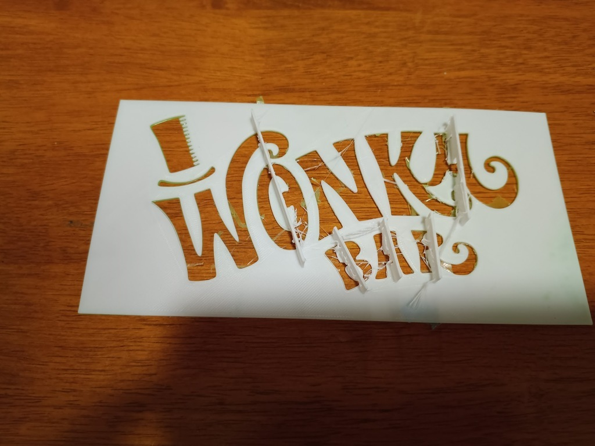
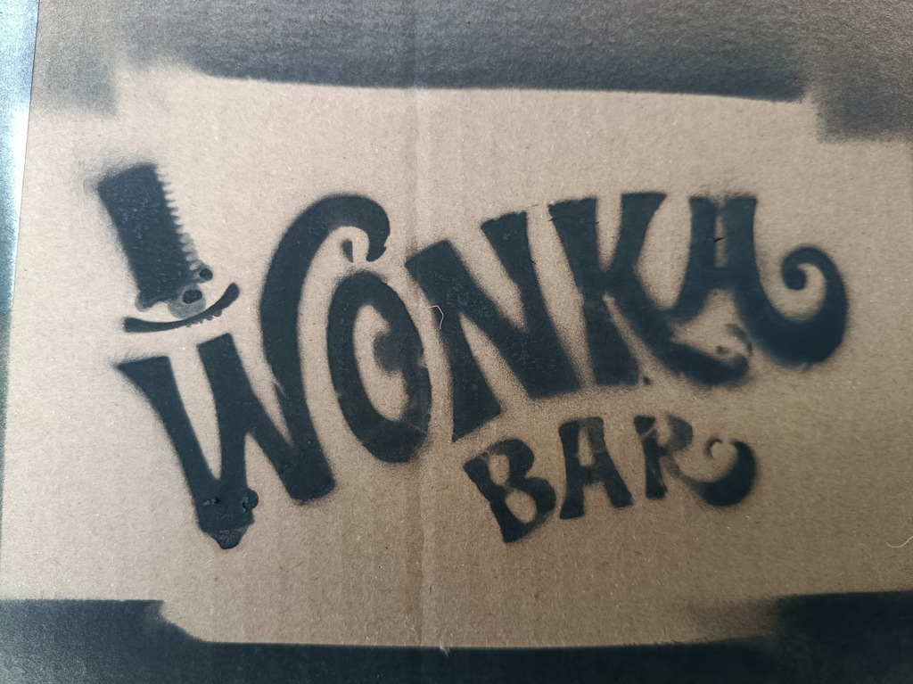
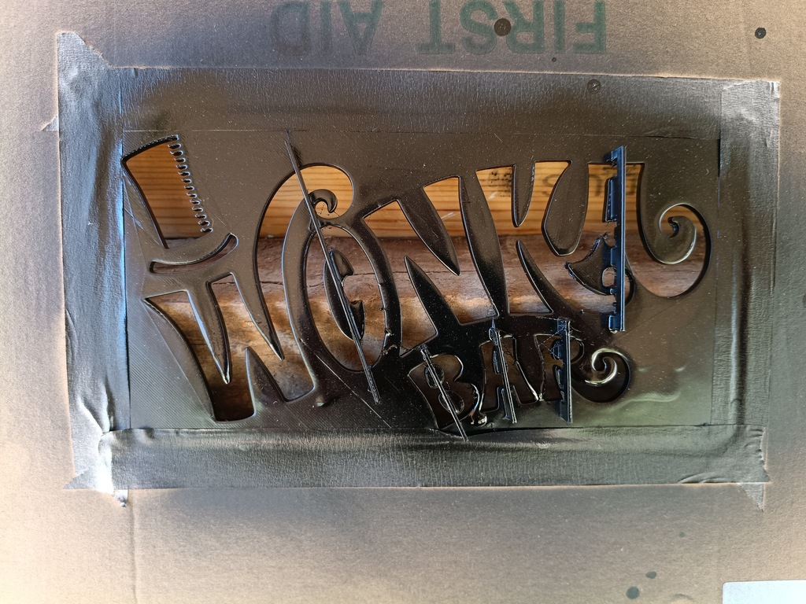
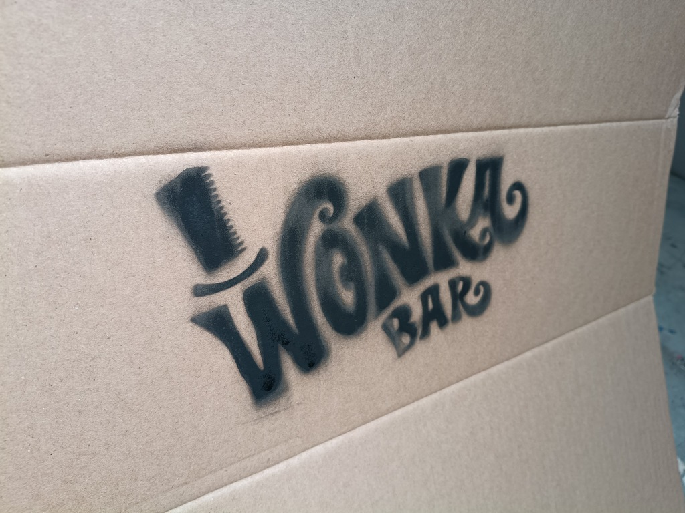

Just is just a little one: for
[an upcoming performance](https://www.dvsingers.org/charlie-and-the-chocolate-factory)
we wanted to stencil some boxes, and cutting out stencils by hand is always a bit of 
a pain, plus the logos we wanted weren't going to be easy to stencilize because of the
small details and the letters with floating islands in them.  So I thought I'd have a go
at 3D printing them, basically a big flat stencil with little "bridges" to hold the
islands in place.

*test stencil*

*test spray*

After a round of testing I made a slightly bigger version.  The most difficult things with
the first round were peeling the stencil off the bed without breaking it, and trimming the
supports, so this version has thicker
bridges and little "legs" in the larger gaps, which can be trimmed off with a sharp pair of side cutters.

I also discovered that once it's been used a couple of times, the drying paint makes the stencil
roll up at the corners and at the sticking out internal details, rendering it useless for further
jobs, so I've made it even thicker.  This doesn't actually add a lot of time and materials, since
(when printed with 0.2mm layers)
a 1mm stencil uses 5 solid layers and a 4mm stencil uses 3 solid layers for the
top and 3 for the bottom, with 14 infill layers between them at 10% density.
So really that's
only 30% more plastic but it should be much less prone to warping.

*Thicker stencil*

*Final spray*

Some further reinforcing would help the stencil last longer without warping,
but not a bad result, and did a stack of these boxes for Wonka's factory scenes ...
