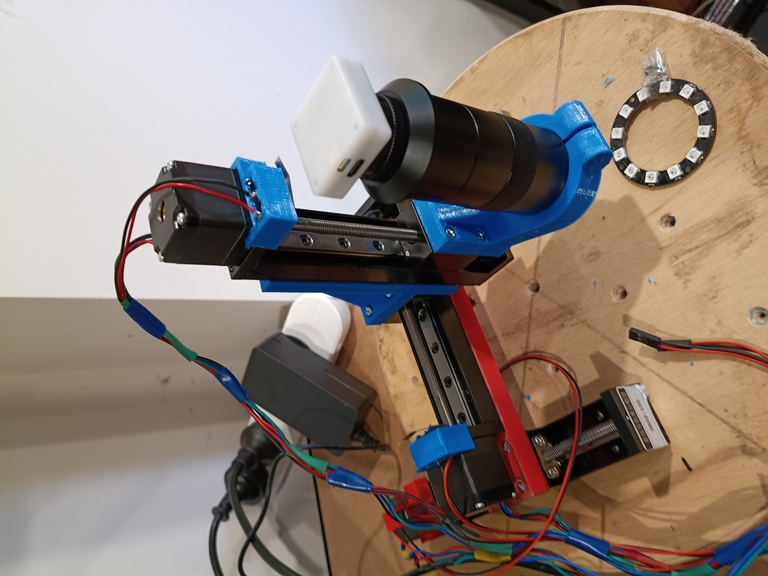
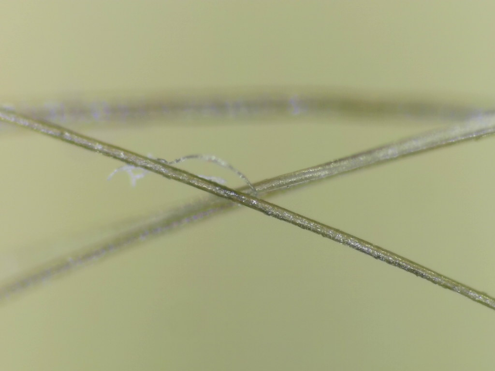
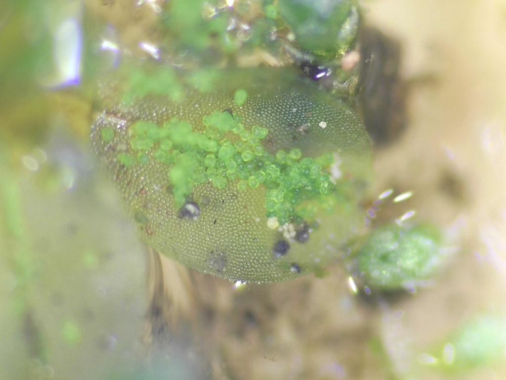
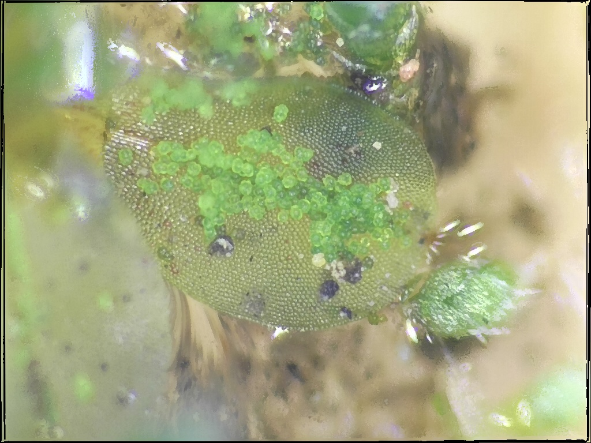
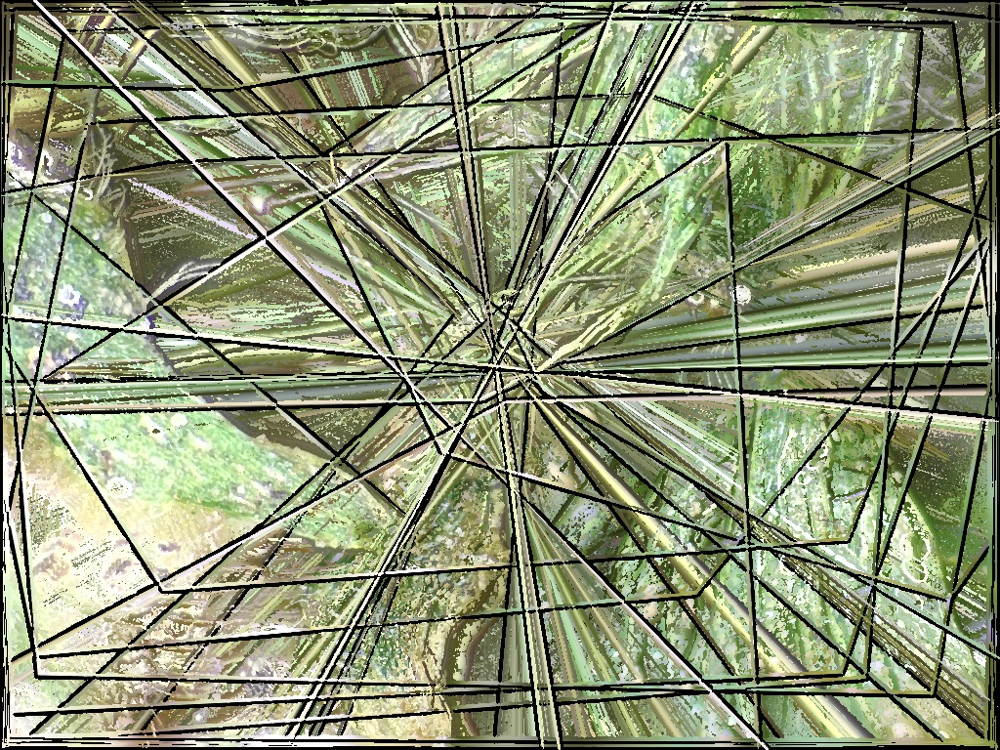

Australia has many excellent zoos of varying size, but this is (probably) the smallest,
at approximately one billionth the size of [Werribee Open Range Zoo](https://www.zoo.org.au/werribee/).
Parking would be kind of a hassle, but you can visit online **SOON** at [tiny.zoic.org](https://tiny.zoic.org/).

This article discusses the history and aims of the project.
For more technical specifics of the software, see 
[the Tiny Zoo repo](https://codeberg.org/nickzoic/tiny-zoo/).

## Species

The microscope is powerful enough to see [various microfauna](https://www.msnucleus.org/watersheds/mission/plankton.pdf)
which can grow to about grow up to 500µm long.

* [Paramecia](https://en.wikipedia.org/wiki/Paramecium) 
* [Tardigrades](https://en.wikipedia.org/wiki/Tardigrade)
* [Rotifers](https://en.wikipedia.org/wiki/Rotifer)
* [Nematodes](https://en.wikipedia.org/wiki/Nematode)

I also found one enormous larva ([coleoptera?](https://en.wikipedia.org/wiki/Beetle))
which came zipping past like an express train.

The aim is to observe living creatures and their behaviours in their environment.
Eventually I hope to have OpenCV detect, record
and follow interesting species.

## Related

* [FARlabs](https://www.farlabs.edu.au/) allows students to perform remote
    experiments with radioisotopes,
    to measure the differences between different types of radiation.
* [Open Flexure](https://openflexure.org/) is a servoed microscope which
    uses microscope lenses and "flexures", bendy bits of 3d print, instead of all
    the metal parts which Tiny Zoo uses. It has a
    12 × 12 × 4mm range of motion and is more aimed at higher
    magnification viewing of prepared slides.

This project may also owe just a *little* something to reading
[James Blish's *Surface Tension*](https://gwijthoff.github.io/globalSF/readings/blish_surface_tension.pdf) at an impressionable age.

## Hardware

*Tiny Zoo prototype*

### Camera & Optics

Currently a 12Mpix USB webcam capable of capturing JPEGs at about 20fps,
see [Using the Waveshare IMX577 Camera from Python](/art/waveshare-imx577-camera-python/)

I've got the setup working with three lenses:

* A "100x" industrial microscope C-mount lens.
    This is really about 1x in microscope terms I think.
* A "4x" microscope objective with a 0.5x C-mount converter
* A "10x" microscope objective with a 0.5x C-mount converter

The "10x" lens works, but depth of field is so thin that it is difficult
to see anything much.  Autofocus works but only if the Z axis moves super
slowly so it can sample enough frames.

*Human hairs through the 4x lens*

I'd like to look at upgrading to an
[infinity corrected lens](https://www.microscopyu.com/microscopy-basics/infinity-optical-systems)
setup as well.
These lenses are more expensive but may offer better sharpness and a more convenient geometry.

I'm also considering mounting two cameras and lenses side by side and allowing
zoom to switch between them, to cover a wider range of zoom than the digital zoom can allow.

### Lighting

Lighting is definitely a big issue here, and I've been experimenting with
lighting from above, below, on the sides, etc.  I think it might end up needing
to have several lights so that lighting can be adjusted depending on the situation.

So far the best setup has been a ring of six LEDs with the lens peeking through the center.
The brightness is controlled from the GRBL boards "spindle PWM" output.

I'm also quite taken with the appearance of
[dark field microscopy](https://en.wikipedia.org/wiki/Dark-field_microscopy)
for this and stumbled upon the
[Arlow-Abbe Condenser](https://www.microbehunter.com/microbehunter-magazine-issue-48/)
which looks like an interesting concept as it would make it possible to switch
lighting options under software control.
The condenser would have to move with the lens though, which would require
significant changes to the stage setup.

### Motion Platform & Controller

The stage is approx 100x100x100 mm using 3 stepper axes with about 1.25µm resolution:

* Motors: 1.8⁰ step angle so 200 steps per rev
* Screws: `Tr6x2(P1)` threads move 2mm per rev so 10µm per step.
* Stepper Drivers: 8 microsteps per motor step so about 1.25µm per microstep.

The axes are connected with 3D printed parts, for
[OpenSCAD](https://openscad.org/) models and more info see
[the repo](https://codeberg.org/nickzoic/tiny-zoo/src/branch/main/models)

### Improved Z axis

The useful range of the Z axis for focussing is only 2-3mm which
makes using a 100mm stage seem a bit silly.
I'm thinking of replacing it with a shorter, lighter, more precise stage
using a geared stepper and a 3D printed
[snail cam](https://en.wikipedia.org/wiki/Cam_%28mechanism%29)

With a microscope lens on board and the long tube (~180mm)
required to adapt it to the camera, there's a noticeable
vibration in the image when moving unless acceleration is severely
limited.  This would be improved with a more compact camera setup
and/or improved kinematics and/or improved rigidity in the stages.

### GRBL Controller

See [Three-axis motion with GRBL](https://nick.zoic.org/art/three-axis-motion-with-grbl/).
A 3-axis [GRBL](https://github.com/gnea/grbl) controller board drives the three axes
and has microstepping drivers so the steppers can be run at 1, 2, 4, 8 or 16 microsteps
per step.

This board controls the lighting as well, using a 12V PWM output intended to 
control a laser for laser cutting.

## Server Software

A really simple [aiohttp](https://aiohttp.org/) based server is under [`server/`](server/).
Static files including HTML, CSS and Javscript are under [`server/static/`](server/static/).

This software is simple enough that it could run easily on an
[RPi](https://raspberrypi.com/) or similar SBC.
It currently doesn't do any image processing, just picks the frames up and sends them.

Autofocus and video clip recording uses [OpenCV](https://opencv.org/)
for image processing so the plan is to run it on a
[Jetson Nano](/art/nvidia-jetson-nano-experiments/) I happen to have laying around,
which has good GPU capabilities plus a [MIPI-CSI2](https://en.wikipedia.org/wiki/Camera_Serial_Interface)
interface for the camera.

### Streaming Images

Images are captured at 1024x768 pixels and served up as
[JPEG frames in a `multipart/x-mixed-replace`](https://docs.aiohttp.org/en/stable/multipart.html#sending-multipart-requests)
[Motion JPEG (MJPG)](https://en.wikipedia.org/wiki/Motion_JPEG) stream.
Clients only recieve frames when they're ready for them, as a primitive
form of throttling.

### Focus Stacking

One way to work around shallow depth of field is to do "Focus Stacking",
where many images at different focal points are combined into one, hopefully
having the sharpest parts of all the images combined.

This is working, but not very well, so I may need to revisit it with a more
sophisticated focus stacking library.

Unstacked | Stacked | Stack Failure
---|---|---
 |  | 

When it works it works, but when it doesn't work it generates spectacular
abstract art `:-)`.

### Capturing Video

Movement is a really important part of identifying small, semi-transparent creatures, so
as well as screenshots users can capture small videos.

To capture video, a `/vid` handler starts a task to enqueue frames, and spawns a process
which uses [OpenCV](https://opencv.org/) to encode frames into an
[AVI](https://en.wikipedia.org/wiki/Audio_Video_Interleave) file using an
[XVID (MPEG4) codec](https://en.wikipedia.org/wiki/Xvid).
OpenCV can only write to a file, not a Python file-like, so the output video is
written to a temporary [FIFO](https://en.wikipedia.org/wiki/Named_pipe)
and the aiohttp handler streams it to the client as it becomes available.

At the moment, videos are 200 frames (about 10 seconds) long, less than 2MB in size.

It's worth investigating if this method will also work to stream video to 
clients, as it'd greatly reduce the amount of data transferred (at the expense
of quite a bit of CPU per client).

There are now [some tinyzoo videos on youtube](https://www.youtube.com/playlist?list=PLQ9TdAYTtlJc) ...

### Autofocus 

The [depth of field](https://photographylife.com/what-is-depth-of-field)
of microscope lenses is very shallow: a matter of microns!
Manually jiggling the Z axis back and forth a micron at a time is pretty tedious.

To perform autofocus, Tiny Zoo jogs the lens up and down a few millimeters,
while capturing frames and comparing their "sharpness".
There are [various methods of measuring focus](https://opencv.org/autofocus-using-opencv-a-comparative-study-of-focus-measures-for-sharpness-assessment/)
with variance-of-Laplacian being "good enough" so far.
Only the central portion of the image is measured, which reduces the 
processing power needed and gives a spot-focus effect.

I've also looked at [Deep learning for single-shot autofocus microscopy](https://opg.optica.org/optica/fulltext.cfm?uri=optica-6-6-794) which
seems like a really interesting way to do autofocus more efficiently.
I've noticed when manually focussing that it's often possible to estimate if
the focal plane is too high or too low
just by looking at the shape of the blur, so this technique seems promising.

### User Interface

Simple Javascript UI should mostly just display the image received, but also
should allow control through many different mechanisms:

* Keyboard controls
* Touch screen 'joystick'/'sliders' in bottom corners.
* Touching image to recenter
* Pinch/stretch image to zoom
* Gamepad API

A "map" of the whole area in reduced resolution would be nice too,
and a scale indicator in mm.

Keyboard controls:

Keys | Purpose
:---:|---
q / e | Focus Up/Down
w / s | Move Y Axis - / +
a / d | Move X Axis 
z / x | Zoom In/Out
c | Capture single image
r | Capture stacked image
v | Capture short video
f | Autofocus

### Communicating with the GRBL controller

The server communicates with the server using [G-code](https://en.wikipedia.org/wiki/G-code)
over serial over USB.  The serial port on this particular controller appears as `/dev/ttyACM0`
or similar under Linux with identifiers `0483:5740 STMicroelectronics Virtual COM Port`.

The server sends [`G0`](https://marlinfw.org/docs/gcode/G000-G001.html) commands to
move the stages and also polls their position using the
[`?`](https://github.com/gnea/grbl/blob/master/doc/markdown/commands.md#grbl-v11-realtime-commands)
realtime command.
A separate task listens to the serial data received from the controller for position updates and
relays these to each connected client.

Eventually some [more sophisticated movement](/art/smooth-move-taming-trajectories-with-polynomials/)
may be implemented but this will do for now.

## Reflector

Eventually it might be a good idea to implement an intelligent proxy which can receive
a single stream from the (each!) microscope and multiplex them out to multiple destinations.
I did get as far as setting up a [linode](https://linode.com/) to host this and configuring
[letsencrypt](https://letsencrypt.org/).

## Other Thoughts

* I need some way to map 'zoom' onto 'pixels per mm' for both movement and for displaying a scale.
* Motion detection and tracking would be lovely.
